<div align="center">

# 🌙 ScoringHero

**Open-source sleep EEG visualization, annotation and scoring**

Developed by Sven Leach · Used by research labs & clinicians alike

[](https://github.com/SvennoNito/ScoringHero/releases/latest)
[](https://github.com/SvennoNito/ScoringHero/releases)
[](#-download)

[📥 Download](#-download) · [Video](#-video-walkthrough) · [Features](#-features) · [File formats](#file-formats) · [Development](#development) · [Support](#support) · [Cite](#cite) · [Report issue](https://github.com/SvennoNito/ScoringHero/issues/new)

</div>

---

## 📥 Download

| Platform | Variant | File | |
|----------|---------|------|---|
| Windows | **Full** (GSSC + NIDRA bundled, about 290 MB) | `auto-scoringhero_windows.exe` | [Download](https://github.com/SvennoNito/ScoringHero/releases/latest/download/auto-scoringhero_windows.exe) |
| Windows | **Lite** (about 80 MB) | `scoringhero_windows.exe` | [Download](https://github.com/SvennoNito/ScoringHero/releases/latest/download/scoringhero_windows.exe) |
| macOS (Apple Silicon) | **Lite** | `scoringhero_mac_arm64` | [Download](https://github.com/SvennoNito/ScoringHero/releases/latest/download/scoringhero_mac_arm64) |
| macOS (Intel) | **Lite** | `scoringhero_mac_x86_64` | [Download](https://github.com/SvennoNito/ScoringHero/releases/latest/download/scoringhero_mac_x86_64) |

Links always point at the newest release. See [all releases and release notes](https://github.com/SvennoNito/ScoringHero/releases).

On macOS, GSSC and NIDRA need the Windows **Full** build or a [source install](#development); macOS downloads are Lite only.

**macOS Gatekeeper:** the app is not Apple-registered. Run `chmod +x scoringhero_mac_<arch>` in Terminal, then System Settings → Privacy & Security → **Open Anyway**.

**Privacy:** ScoringHero runs fully locally and sends no data.

---

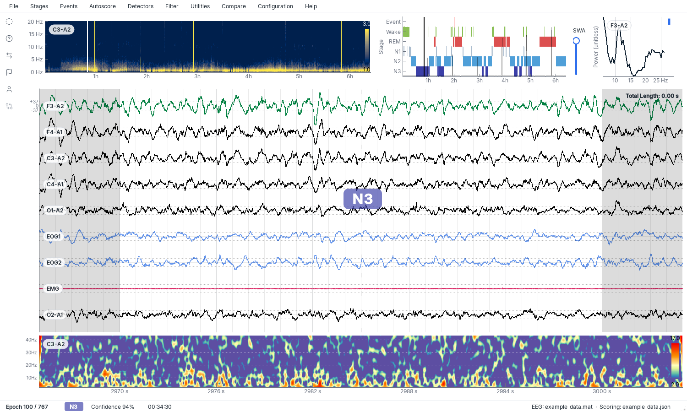

## 🎬 Video walkthrough

https://github.com/user-attachments/assets/069d6ed9-d5ff-43c1-8521-0c32c8efeef3

---

## ✨ Features

<details>
<summary><strong>Scoring</strong></summary>

- Keys: `W`, `1`, `2`, `3`, `R`, `I` (Inconclusive), `Delete` clears, `Q` flags an epoch as uncertain
- The **stage badge** over the EEG shows the current stage (drag it anywhere; size and visibility in Configuration → General). With a comparison loaded and disagreeing it reads e.g. *N2 vs N3* with a red border.
- The status bar shows epoch (click, type a number, Enter to jump), stage, confidence, clock time, EEG and scoring file.


</details>

<details>
<summary><strong>Signal display</strong></summary>

- Multiple channels with per-channel scaling, shift, color, line width; amplitude reference lines, 1 s grid
- Time axis in seconds, minutes, hours or clock time (set the recording start in the configuration)
- **Stack channels** on one baseline, or **robustly z-standardize** (median/IQR) to compare channels
- **Zoom**: draw a rectangle and press `Z`.

</details>

<details>
<summary><strong>Navigation</strong></summary>

`←`/`→` step epochs; jumps wrap around. The left navigation bar has one button per jump: next **unscored**, **uncertain** (confidence < 0.5), **stage transition**, **event**, **human-scored**, **disagreement** (needs comparison). Clicking the hypnogram or spectrogram jumps to that time.

</details>

<details>
<summary><strong>Events</strong></summary>

- 13 types: Artefact (`A`) + 12 customizable (`F1`–`F12`) with own names and colors
- Draw by click-and-drag (live duration/amplitude), press the key to assign; overlapping same-type events merge
- Double-click an event to remove it; hold a key and click an event to relabel it; `Backspace` erases events inside the drawn selection
- Shown on signal and hypnogram

<p align="center">
    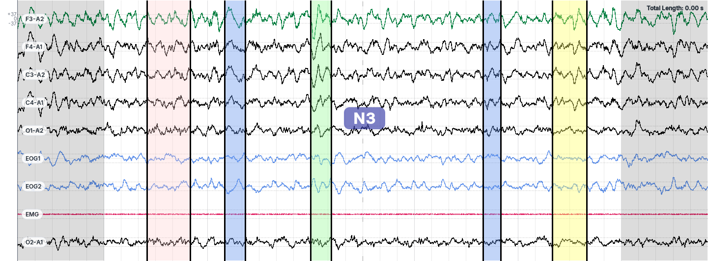
</p>

</details>

<details>
<summary><strong>Compare scoring</strong></summary>

**Compare → Scoring → Import scoring for comparison.** Disagreements are highlighted in the hypnogram, the *Next disagreement* jump uses them, and a statistics window shows Cohen's kappa and per-stage agreement.

<p align="center">
    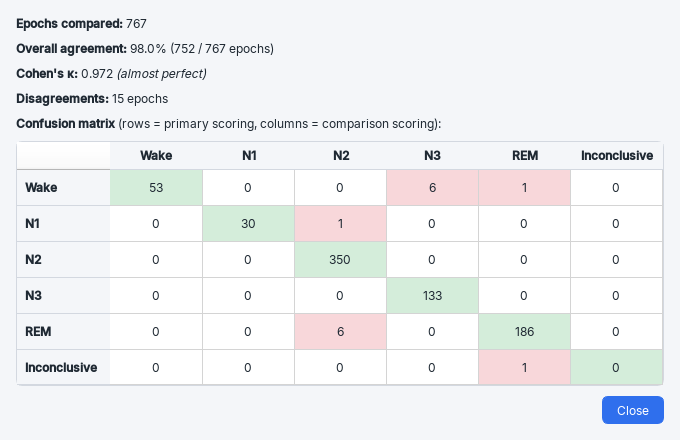
    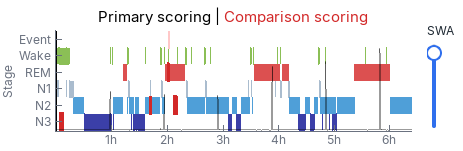
</p>

</details>

<details>
<summary><strong>Panels</strong></summary>

**Spectrogram** — Welch PSD of the full night (4 s Hann, 2 s hop), cached; channel, frequency range, power limits and colormap configurable

<p align="center">
    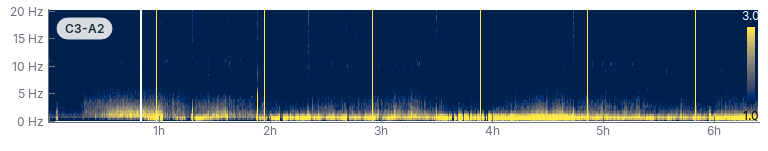
</p>

**Hypnogram** — color-coded stages, events, and a **slow-wave activity** overlay (delta 0.5–4 Hz, smoothing slider)

<p align="center">
    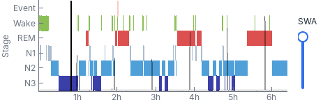
</p>

**Periodogram** — Welch spectrum of the epoch or of a rectangle drawn on the signal; modes 1/f removed, dB, raw

<p align="center">
    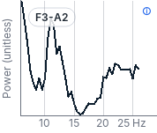
</p>

**Wavelet** — complex Morlet via FFT convolution, adaptive cycles (3 to f/2), padded epoch against edge artifacts; 4 normalizations (raw, L2, z, dB median baseline), linear/log axis, optional ridge, can be hidden

<p align="center">
    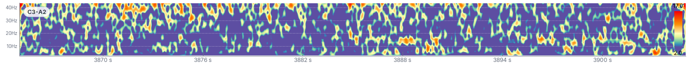
</p>

</details>

<details>
<summary><strong>Filtering</strong></summary>

- **Filtering** (`Ctrl+F`): per-channel high-pass, low-pass and notch (zero-phase Chebyshev II), with a live magnitude response. Cutoff is the −3 dB point; order sets roll-off. Filters affect the displayed signal and all derived spectra.

<p align="center">
    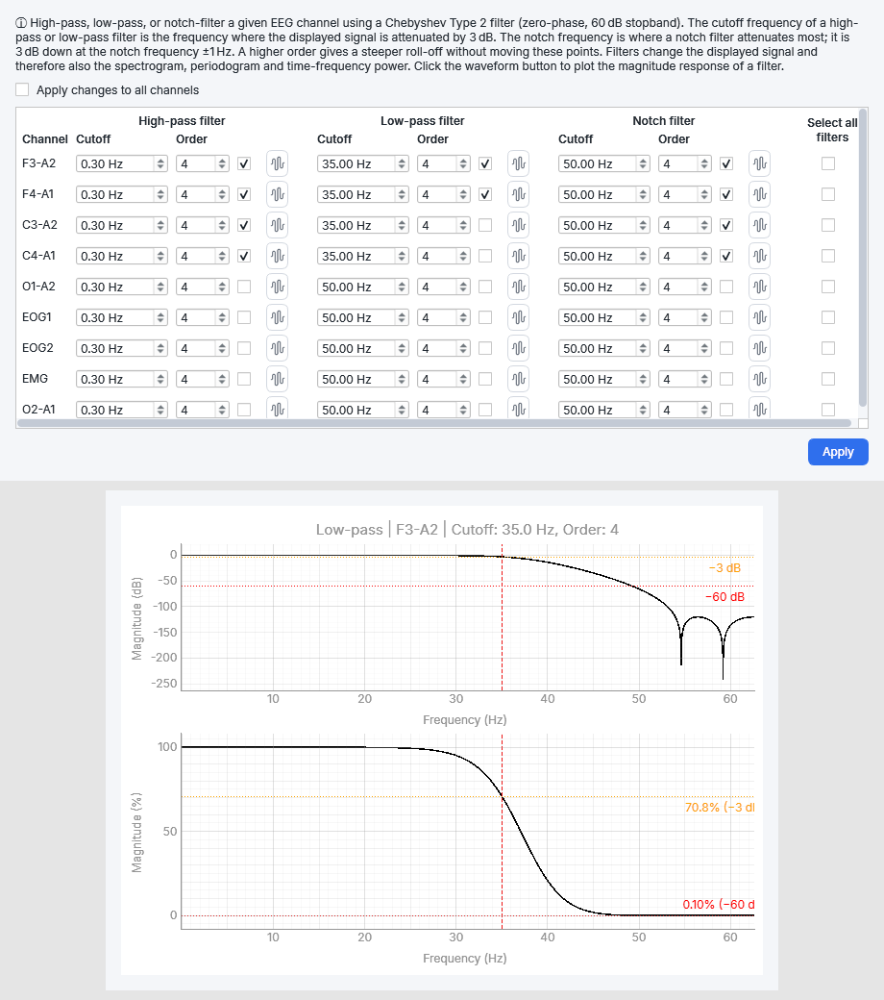
</p>

</details>

<details>
<summary><strong>Automatic detection and scoring</strong></summary>

- **MT-KCD / MT-Spindle** (`Ctrl+K`, Detectors menu): multitaper K-complex and spindle detection with amplitude/slope thresholds, optional stage restriction; results become normal events.

<p align="center">
    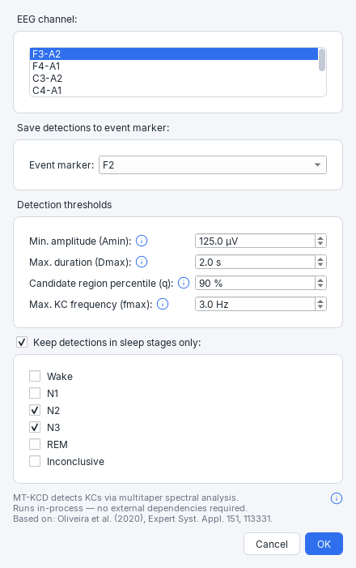
    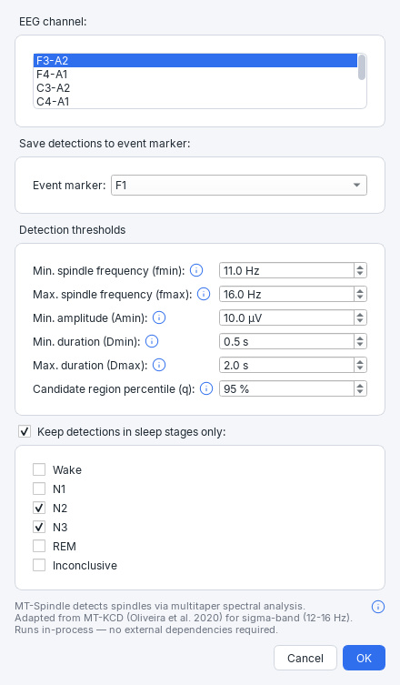
</p>

- **GSSC** (`Ctrl+G`): Greifswald Sleep Stage Classifier for scalp EEG/EOG; optional 0.3–30 Hz bandpass.
- **NIDRA ezscore-f** (`Ctrl+N`): artifact-aware scoring for two-channel forehead EEG ([Coon et al. 2025](https://doi.org/10.1101/2025.06.02.657451), ONNX models from [NIDRA](https://github.com/paulzerr/nidra), weights downloaded on first use). Artifact epochs are left unscored/Inconclusive and flagged; can store hypnodensity. Needs `uv sync --extra nidra`, see [NIDRA_SETUP.md](NIDRA_SETUP.md).

<p align="center">
    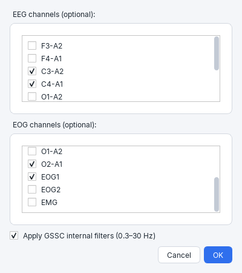
    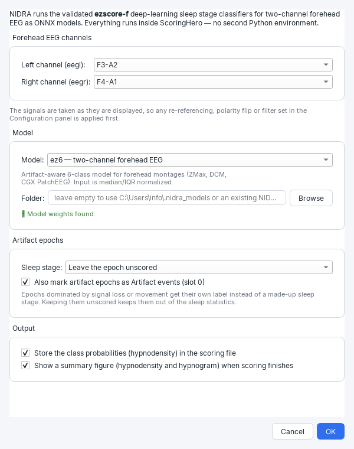
</p>

Predictions are imported as a scoring you can review, correct and export.

</details>

<details>
<summary><strong>Sleep report (PDF)</strong></summary>

**File → Export → Sleep Report**: hypnogram, whole-night spectrogram, example EEG trace, TST/TRT/efficiency, stage distribution, N2/N3/REM latencies.

<p align="center">
    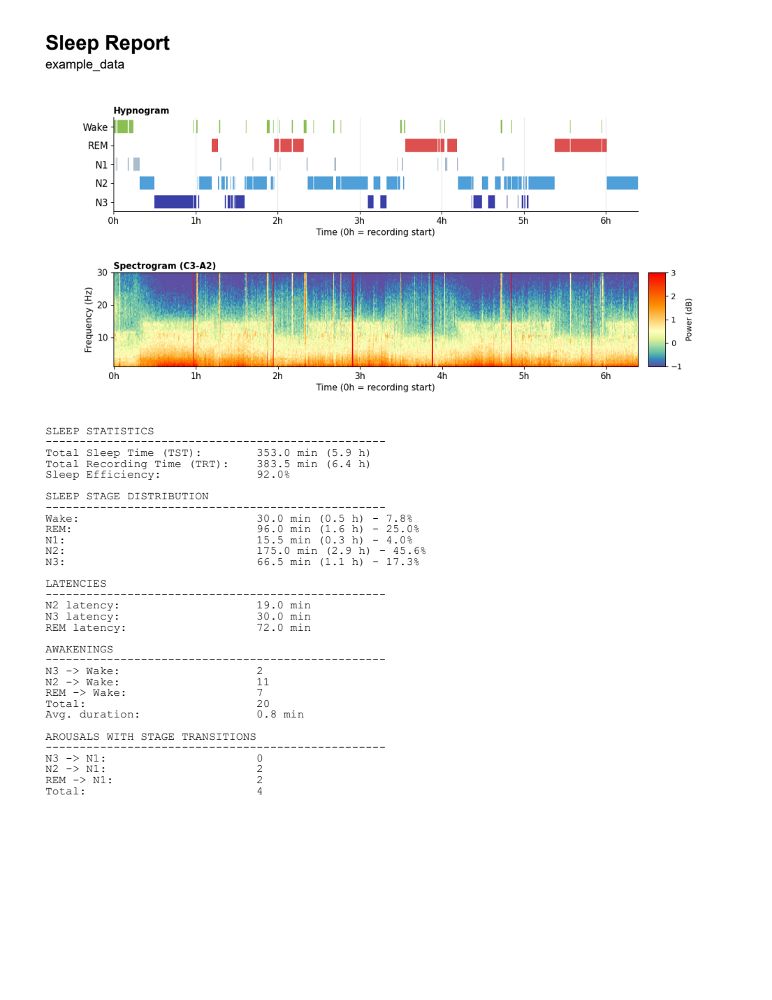
</p>

</details>

<details>
<summary><strong>Configuration</strong></summary>

`Ctrl+C`; saved per recording as `{filename}.config.json`.

- **General**: sampling rate, epoch length, channel distance, reference line, wavelet padding, time unit, recording start, stage badge
- **Channels**: name, visibility, color, scaling, shift, line width; stack / z-standardize
- **Events**: names, colors, counts and durations, delete per type
- **Spectrogram / Periodogram / Wavelet**: channel, frequency limits, power limits, mode, colormap

<p align="center">
    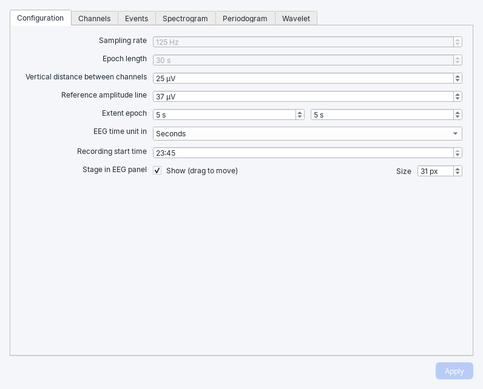
    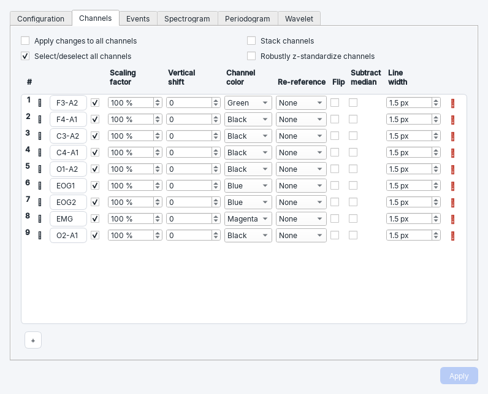
    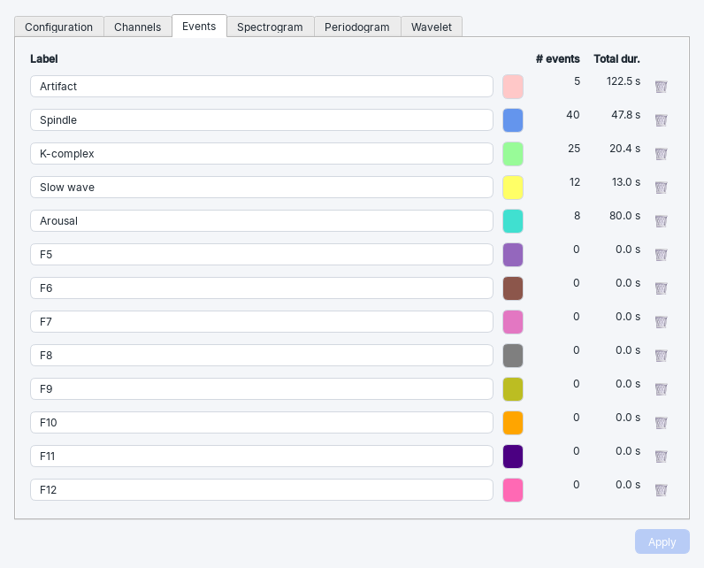
</p>

</details>

<details>
<summary><strong>Keyboard shortcuts</strong></summary>

| Key | Action |
|-----|--------|
| `W` `1` `2` `3` `R` `I` | Score Wake / N1 / N2 / N3 / REM / Inconclusive |
| `Delete` / `Q` | Clear score / toggle uncertain |
| `A`, `F1`–`F12` | Mark drawn region as event; hold + click relabels |
| `Backspace` | Erase events in drawn selection |
| `←` `→` | Previous / next epoch |
| `Z` | Zoom on selection |
| `Ctrl+S` / `Ctrl+C` / `Ctrl+F` | Save / configuration / filter |
| `Ctrl+G` / `Ctrl+N` / `Ctrl+K` | GSSC / NIDRA / MT-KCD |
| `Ctrl+H` | Help |

</details>

---

## File Formats

<details>
<summary><strong>EEG import</strong></summary>

| Format | Ext. | Notes |
|--------|------|-------|
| EEGLAB | `.mat` | v5 and v7.3 (HDF5); needs `EEG.data` (channels × samples; transposed auto-fixed), `EEG.srate`, `EEG.chanlocs(i).labels` (missing → `CH1…`) |
| EDF | `.edf` | via pyedflib; a Volt-scaled variant converts to µV |
| BDF | `.bdf` | BioSemi 24-bit; read directly; annotation channels dropped |
| Zurich R09 | `.r09` | legacy; fixed 9 channels at 128 Hz (`F3-A2, F4-A1, C3-A2, C4-A1, O1-A2, O2-A1, EOG1, EOG2, EMG`), `int16` |

</details>

<details>
<summary><strong>Scoring import</strong></summary>

| Format | Ext. | Encoding |
|--------|------|----------|
| ScoringHero | `.json` | native: stages, events, confidence |
| YASA | `.txt` | one token per line: `W/WAKE`, `N1/NREM1/1`, `N2/NREM2/2`, `N3/NREM3/3`, `R/REM/4` |
| Sleeptrip | `.csv` | numeric column: 0 W, 1 N1, 2 N2, 3 N3, 5 REM |
| Sleepyland | `.annot` | tab-separated, col 1 stage (`W N1 N2 N3 R`), col 5 `pW=..;pN1=..;…` used as confidence |
| GSSC | `.csv` | header `Epoch, Time, Stage, Conf_W, …, Conf_R`; 0 W, 1 N1, 2 N2, 3 N3, 4 REM |
| Zurich VIS | `.vis` | first line offset, then `<epoch> <code> [comment]`; `0 1 2 3 r`, `e` = repeat previous; 20 s epochs |

Epoch-count and stage-name mismatches are checked for every format: one extra/missing epoch is dropped/filled with a warning; more asks to cancel or truncate/copy the last epoch; unknown stages ask to cancel or set *unscored*.

</details>

<details>
<summary><strong>Native JSON schema</strong></summary>

Saved as `{filename}.json` next to the EEG: `[ <stages>, <annotations> ]`.

```json
{"epoch": 1, "start": 0, "end": 30, "stage": "N2", "digit": -2,
 "confidence": 0.85, "channels": ["C3"], "clean": 1, "source": "YASA"}
```
`stage` (wins on load): `Wake` 1, `N1` −1, `N2` −2, `N3` −3, `REM` 0, `Inconclusive` 2, `null` unscored. `epoch`, `start`, `end`, `digit` are derived.

```json
{"key": "A", "event": "Spindle", "digit": 0, "counter": 3, "epoch": 7, "start": 195.2, "end": 196.8}
```
`digit` is the event type 0–12 (0 = Artefact, 1–12 = `F1`–`F12`).

</details>

---

## Development

<details>
<summary><strong>From source</strong></summary>

Needs [uv](https://docs.astral.sh/uv/getting-started/installation/), Python 3.13 or newer (the exact version is pinned by `uv`).

```bash
git clone https://github.com/SvennoNito/ScoringHero.git
cd ScoringHero
uv sync
uv run scoringhero.py
```

<details>
<summary><strong>Build binaries</strong></summary>

Windows: `uv sync --extra build-win && ./build-win.bat` (→ `dist/scoringhero.exe`)

macOS: `uv sync --extra build-mac && arch -arm64 ./release-mac.sh` (or `-x86_64`)

</details>

</details>

<details>
<summary><strong>Code layout</strong></summary>

`scoringhero.py` entry; `ui/` layout; `widgets/` custom widgets; `eeg/` loaders; `scoring/` import/export; `signal_processing/` spectrogram, wavelet, periodogram, SWA; `autoscoring/` GSSC, NIDRA; `event_detection/` detectors; `export/` reports; `config/`, `cache/`, `style/`, `tests/`. Terms in [GLOSSARY.md](GLOSSARY.md). Dependencies in [pyproject.toml](pyproject.toml).

</details>

<details>
<summary><strong>Contributing</strong></summary>

Commit subjects: `[NEW]` feature, `[FIX]` bug fix, `[MOD]` change/refactor, `[DOC]` docs.

</details>

## Support

This software is free to use for research, and always will be. If it improved your workflow and you want to support this work, ⭐ the repository (top right). Outreach is the currency that success is measured in. If you'd like to support it financially or say thank you, you can 

[](https://ko-fi.com/Svennonito)

[](https://github.com/sponsors/SvennoNito)
  
## Cite

Cite via the metadata in [`CITATION.cff`](CITATION.cff) (or GitHub's *"Cite this repository"* button, top right), e.g. APA:

<!-- CITATION:START -->
> Leach, S. (2026). *Scoring Hero* (Version 0.3.1) [Computer software]. https://github.com/SvennoNito/ScoringHero
<!-- CITATION:END -->
